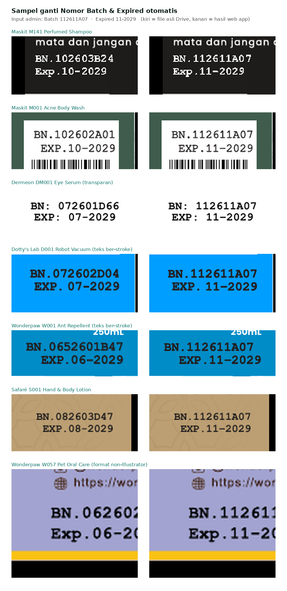

# Sistem Request Cetak Sticker Kemasan

Web app admin & user untuk mengajukan cetak sticker kemasan, langsung dari database sticker di Google Drive.



## Fitur

**User / tim**
- Pilih **brand** → **cari nama sticker** (nama / kode / nama file) → pilih **variasi** (volume, label/box, transparan, halal, dll).
- Setiap variasi menampilkan **gambar visual** (thumbnail dari Drive, bisa diperbesar) dan **ukuran dimensi** yang diambil dari nama file (mis. `8,5 x 7 cm`).
- Produk/brand yang **belum ada di database** bisa diisi manual — tombol *Input manual* baru terbuka setelah user mencari di database, wajib centang konfirmasi, dan aplikasi menampilkan produk mirip agar tidak dobel (nama brand, nama produk, jenis kemasan, ukuran, link referensi opsional). Isi **jumlah cetak**, **supplier** — untuk **sticker/label wajib PWD atau Kame**; untuk **flexible packaging & box** tersedia Kame, PWD, Jawara Pouch, Flexypack Sachet & Pouch, Juke Sachet & Pouch, Lainnya, atau *Belum tahu — dipilih Purchasing* (tim Purchasing wajib memilih suppliernya sebelum membuat PR / menandai Naik Cetak), **tanggal request**; satu request bisa berisi banyak sticker.

**Jenis desain** — setiap file otomatis dikenali sebagai **Sticker / Label**, **Flexible Packaging** (pouch, standing pouch, sachet, three side seal, spout), atau **Box / Karton**, dari nama file & folder (`(LABEL)`, `Lebel`, `(POUCH)`, `SACHET`, `KEMASAN`, `(BOX)`, ukuran 3 dimensi, dan ukuran pouch standar ≥ 13×19 cm). Label jenis tampil di setiap visual, di form request, di PDF, dan bisa dipakai sebagai filter. Admin dapat mengoreksi jenis per file di *Kelola Katalog*; koreksi manual tidak tertimpa saat sinkron.

**Riwayat & progress bersama** — semua user bisa melihat seluruh request tim (*Semua Request*) dan riwayat per sticker (*Riwayat Pemesanan*), lengkap dengan filter tim/tanggal/status. Saat memilih sticker muncul info *terakhir dipesan* dan peringatan bila desain yang sama sudah dipesan dalam 30 hari terakhir; saat kirim request, user wajib konfirmasi bila terdeteksi kemungkinan order ganda. Progress tiap request: **Diajukan → ACC Desainer → ACC Purchasing → Naik Cetak → Terkirim** (Naik Cetak & Terkirim diisi tim Purchasing/Admin, dengan tanggal & catatan).

**Persetujuan** — **Desainer dan Purchasing** wajib **ACC + tanda tangan digital** (Manager Desain dapat memantau semua request) (digambar di layar, bisa disimpan). Request baru bisa ditandai *Naik Cetak* setelah keduanya menyetujui; satu penolakan (dengan alasan) menghentikan request.

**Admin**
- **Generator nomor batch & expired**: admin mengetik batch & expired baru → aplikasi mengunduh PDF asli dari Drive, mengganti teks `BN.xxxx` / `EXP.MM-YYYY` (font Courier New) di posisi, ukuran, warna, dan stroke yang sama, lalu memberi **link download PDF siap cetak**. Bisa dari detail request (per item) atau dari menu *Generator Batch & Exp*.
- **Ringkasan PDF request** untuk vendor: visual sticker, ukuran, jumlah, supplier, batch/exp, **link file mentah Google Drive** + link file siap cetak, dan kotak tanda tangan 3 pihak. Bisa juga dipecah **per supplier**.
- **Purchase Request ke vendor** (PDF formal ber-kop & logo **PT SAINSGO KARYA INDONESIA**, Jl. Raya Pasir Putih No. 147, Sawangan, Depok · admin@sainsgo.com): dari detail request yang sudah disetujui 3 pihak, klik **+ PR <vendor>**. Berisi nomor `PR/SKI/YYYY/MM/NNNN`, data vendor (tersimpan untuk PR berikutnya), tabel barang (jenis kemasan, ukuran, batch/exp, jumlah — tanpa harga), Pengiriman (alamat kirim), File Cetak (link file siap cetak + file master Drive), Ketentuan, tanda tangan (Dibuat · Diperiksa Desainer · Disetujui Purchasing · Konfirmasi Vendor), dan lampiran visual desain. Bisa dibuat oleh Admin atau Purchasing.
- **Kop Surat & PR**: nama, alamat, email, kota, alamat kirim default, dan logo (bawaan: logo Sainsgo, bisa diganti).
- **Laporan PDF** rekap per periode/status.
- **Kelola katalog**: tambah produk baru (nama, kode, detail, link Drive) → langsung tampil di sisi user. Atau tombol **Sinkron dari Google Drive** untuk membaca ulang folder database.
- Kelola pengguna & role, dengan pilihan divisi/tim: Tim Produksi, **Tim Packing**, **Tim Gudang**, Desain, Purchasing, Marketing (atau ketik sendiri).

## Tampilan

Tema tosca + kuning mengikuti warna logo Sainsgo. Responsif untuk ponsel, tablet, dan laptop/PC: di ponsel menu menjadi laci samping, tabel berubah menjadi kartu, dan dialog tampil layar penuh. Ditujukan untuk browser modern (Chrome, Edge, Firefox, Safari/iOS, Samsung Internet — versi 2020 ke atas).

## Menjalankan

Butuh Node.js 22.5+.

```bash
npm install
npm start
```

Buka http://localhost:3000. Akun awal (segera ganti password di menu *Profil*):

| Username | Password | Role |
|---|---|---|
| admin | admin123 | Admin |
| desainer | ganti123 | Desainer |
| manager | ganti123 | Manager Desain |
| purchasing | ganti123 | Purchasing |
| user | ganti123 | User / tim |

Variabel lingkungan opsional: `PORT`, `DATA_DIR` (database SQLite, thumbnail, file hasil generate), `BASE_URL` (URL publik untuk link di PDF), `ADMIN_PASSWORD`, `DEFAULT_PASSWORD`.

Panduan deploy lengkap (Railway, VPS, komputer kantor) + checklist & backup: lihat **[DEPLOY.md](DEPLOY.md)**.

Docker:

```bash
docker build -t request-sticker .
docker run -p 3000:3000 -v sticker-data:/data -e BASE_URL=https://sticker.domainanda.com request-sticker
```

## Database sticker (Google Drive)

Katalog dibaca dari folder Drive `1GsGIB3-t1CGPKtiqNj7ImMG6Xfj3iPPx` (harus dibagikan *Siapa saja yang memiliki link*), tanpa API key. Konvensi yang dibaca:

```
! Brand/                         ← folder brand diawali "!"
  M141. Nama Produk/             ← kode + nama produk
    [subfolder opsional: HALAL, Stiker untuk Box, (Transparan) …]
    M141. Nama - 8,5 x 7 cm.pdf  ← ukuran diambil dari nama file
```

Folder arsip vendor (`1. Vendor - …`) diabaikan. Snapshot awal ada di `seed/drive-tree.json` agar aplikasi langsung jalan; perbarui dengan tombol *Sinkron* atau `npm run sync`.

## Catatan generator batch/exp

- Teks dideteksi otomatis dari pola `BN.` / `BN:` / `No. Batch` dan `EXP.` / `Exp.` / `ED`. Admin cukup mengetik nilainya (tanpa awalan); awalan asli dipertahankan.
- Stroke yang di-expand Illustrator dibersihkan dan diterapkan ulang ke teks baru, jadi tidak ada "bayangan" angka lama. Data edit Illustrator (PieceInfo) yang masih berisi angka lama dibuang dari PDF hasil.
- Uji pada 40 sticker acak: 31 berhasil, 0 rusak; sisanya tidak punya teks batch hidup (sudah di-outline / tidak ada batch) dan aplikasi menampilkan pesan jelas.
- Lihat `fonts/README.md` untuk memakai Courier New asli.

## Tes

```bash
npm test
```
